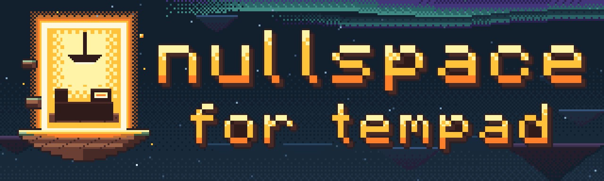
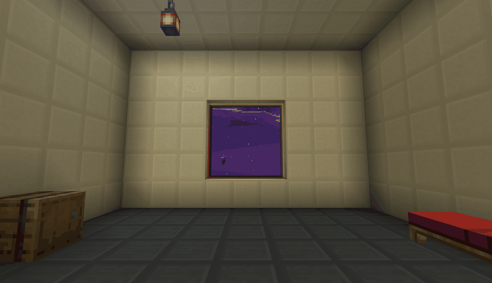
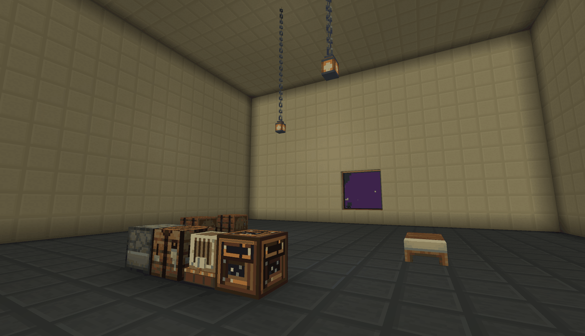
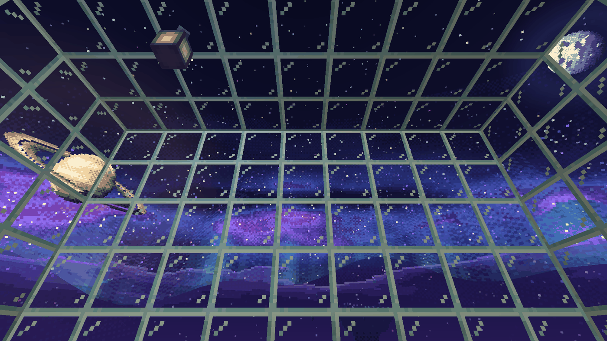
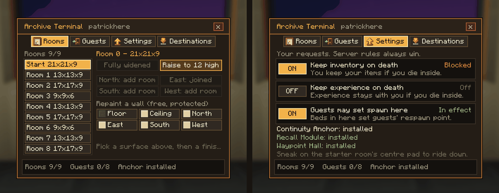
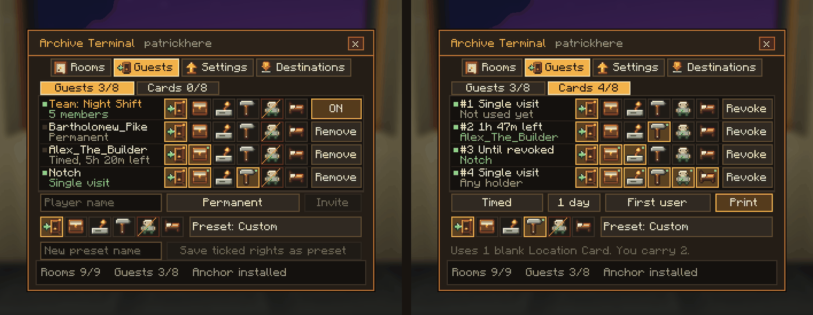
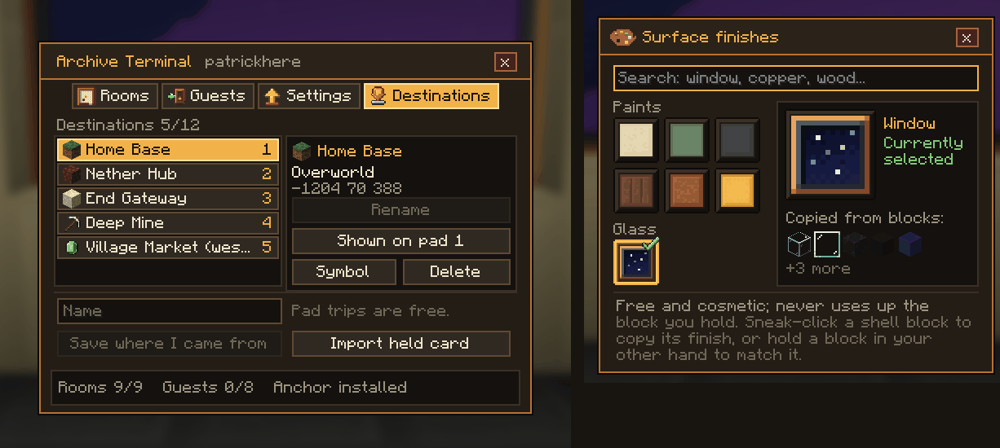
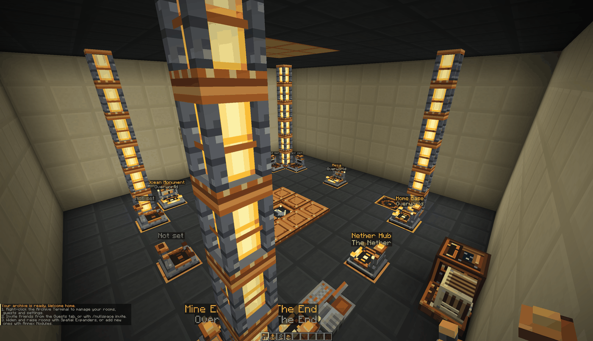
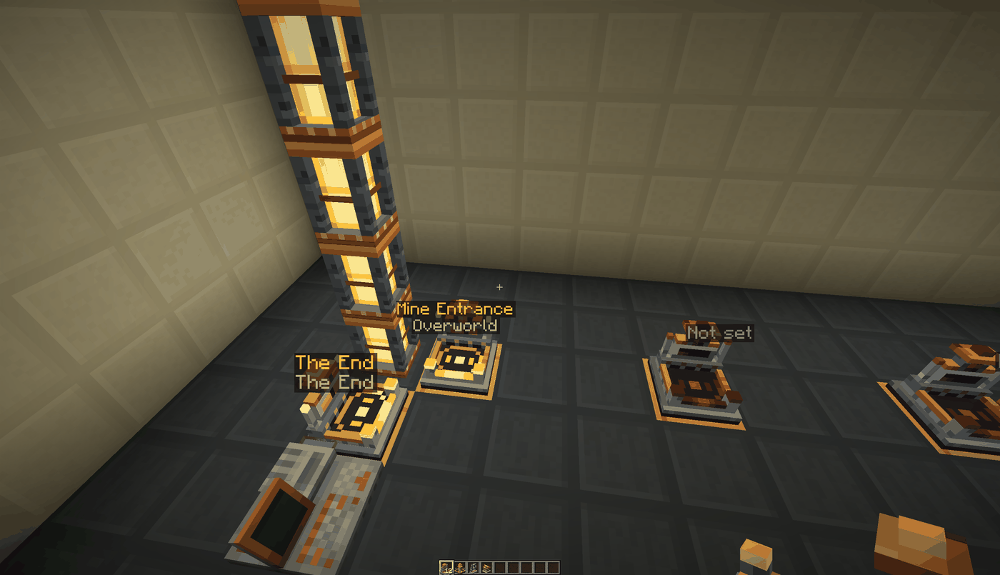
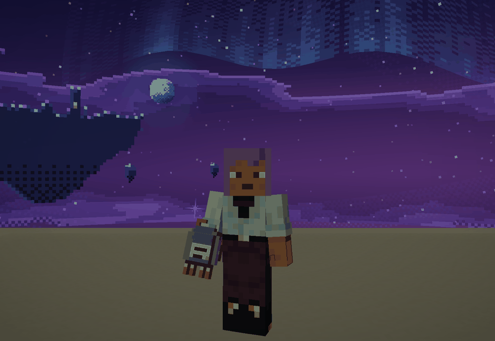

a pocket workshop for every player, reached through [tempad](https://github.com/terrarium-earth/Tempad) gateways. each player owns an archive: a furnished room in a shared starfield dimension that grows as you feed it materials.

an addon for tempad, so it needs tempad. neoforge 1.21.1. the source, the issue tracker and the releases live here.

## what's in it

- archive rooms: start at 9x9 and widen to 13x13 or 17x17, raise the ceiling from 6 to 9 to 12, up to nine rooms joined by tunnels. the starter room can become a 21x21 grand hall
- guests: invite players with fine-grained rights (enter, storage, build, interact, set spawn), permanent or timed, and change them live. admin is never handed out
- archive cards: tempad location cards that act as passes (single visit, timed, or until revoked)
- teams: share an archive with an ftb teams party. it is opt-in per archive
- the shell: repaint walls, floor and ceiling for free, glass included, with a window onto the archive's own void sky (aurora, planets, drifting islands)
- continuity anchor: keeps the archive running while nobody is in it
- recall module: the exit leads back to wherever you died
- waypoint hall: sits under the starter room, with a lift and destination pads that open your tempad destinations
- archive link tape: a tempad upgrade that lists your archive in a full tempad. archive circle access works with the screening device and chronomark
- starter rooms for create, sophisticated storage, handcrafted, supplementaries and farmer's delight, offered only when the mod is installed

## what it looks like

*the starter room as a new archive builds it, with a window on the south wall.*

*the starter room grown into the grand hall. the terminal and the exit never move.*

*every wall, floor and ceiling can be glass. the sky is drawn for the whole archive, not only the window.*

*the terminal's rooms and settings tabs.*

*guests with the pinned team row, and the cards view.*

*destinations, and the searchable finish brush palette.*

*the waypoint hall: a lift at the centre and destination pads with floating labels. bound pads are lit, unbound ones are dark.*

*destination pads up close.*

*the access cartridge in hand.*

the terminal shots use made-up sample names. the rooms, hall and held-item shots are real worlds built by the mod. every screenshot comes from a development client and shows only nullspace's own art and vanilla textures.

## where it came from

nullspace is an addon for [tempad](https://github.com/terrarium-earth/Tempad) by terrarium. it links against tempad and uses its visuals and sounds through the game. no tempad assets are copied or bundled, and the art here is original, made to sit next to tempad's rather than copy it.

## install

needs neoforge 21.1.252 or a later 21.1.x, minecraft 1.21.1 and tempad 3.0.4 or a newer 3.0.x, plus tempad's own libraries: resourceful lib, resourceful config and kotlin for forge. install it on the server and on every client.

optional, never bundled, and nullspace runs without all of them:

- ftb teams: team access
- open parties and claims, ftb chunks: claiming inside the archive is refused when either is installed
- carry on: pickup and put-down follow the archive's permissions

## building

java 21 exactly. `./gradlew build` puts the jar in `build/libs`. `./gradlew test` runs the unit tests, and `./gradlew runGameTestServer` runs the gametests on a real server.

## reporting issues

use the issue forms: bug, feature request, or compat report for a mod that misbehaves next to nullspace. include your nullspace, neoforge and tempad versions. if it breaks while you're running other mods, tell me here, not the authors of those mods. security problems go through the private report link in [SECURITY.md](.github/SECURITY.md).

## help with the art

we'd love help on the art: blocks, items, the gui, textures and models. if you want to pitch in, come say hi in the [discord](https://discord.gg/ZmmtPNJUcK) or open an issue. you don't need to have shipped a mod before.

## licence

code is mit (`LICENSE`). original art, sounds and models are cc by 4.0 (`LICENSE-ASSETS.md`). dependency licences and what is and isn't bundled are in [THIRD_PARTY.md](THIRD_PARTY.md).

neoforge 1.21.1. mit and cc by 4.0 licensed.

nullspace is not an official minecraft product. it is not approved by or associated with mojang or microsoft.
